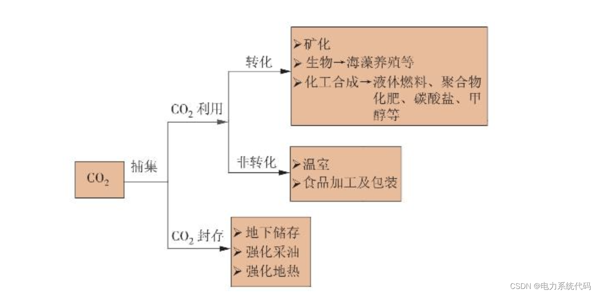
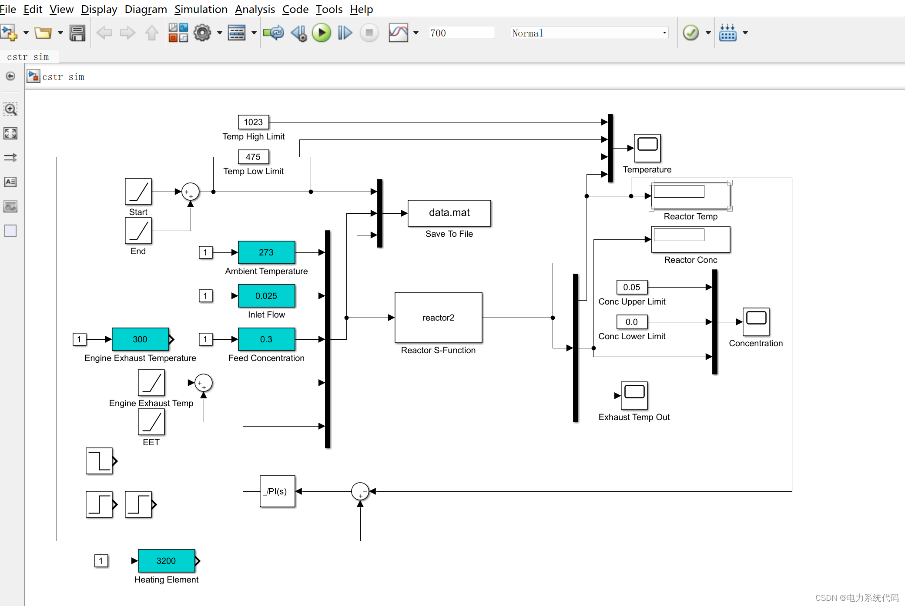
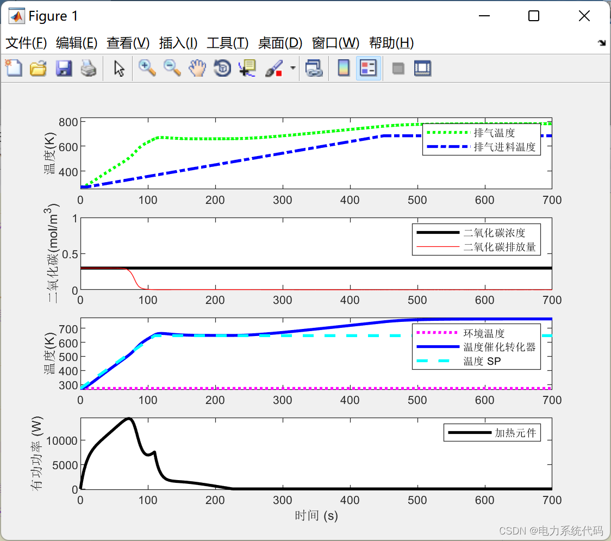

# Simulink | "Dual Carbon" Background: Electric Vehicle Emission Reduction and Carbon Dioxide Emissions

​  
Contents
I. Overview
II. Model
3. Simulink Model
IV. MATLAB Code
Editor
I. Overview
Excessive emissions of greenhouse gases can amplify the greenhouse effect, leading to the occurrence of extreme climates worldwide and severely impacting human survival and development. Therefore, controlling greenhouse gas emissions has become a focal point in current environmental protection efforts. According to statistics from the Intergovernmental Panel on Climate Change (IPCC), global CO2 emissions due to the use of fossil fuels are approximately 237 billion t/a. In response to global climate issues, China proposed its "dual carbon" goals in 2020, aiming to peak CO2 emissions by 2030 and strive for carbon neutrality by 2060.The determination of the "dual carbon" goal. For the industrial system. Especially in the energy and electricity industry, where CO2 emissions account for 40%. Brought about a profound impact. It also guides the layout and development of industrial structure.
CCUS is a key technology for achieving carbon neutrality goals, with the potential to provide 1.1 billion to 2.7 billion tons of carbon reduction by 2050. The United States has been among the first to integrate CCUS technology into carbon markets, currently having 14 commercial CCUS projects in operation. There are mainly four CO2 capture methods in CCUS technology: absorption, adsorption, membrane, and cryogenic freezing. The captured CO2 can be either stored or utilized in two ways: one is geological storage and solidification, or enhancing the extraction of resources such as oil and natural gas; the other is synthesizing valuable chemicals, such as beverages and food additives. The technical pathways for carbon utilization and storage are shown in Figure 1.
Editor
As cars become an increasingly integral part of daily life, air pollution and its primary impacts on health are becoming increasingly pressing concerns. According to data from the World Health Organization, "It is estimated that 1.3 million people die annually worldwide due to outdoor urban air pollution. When experiencing high levels of air pollution, the quality of life for infants, the elderly, and those with respiratory diseases is severely affected. In addition to adverse effects on human health, the Environmental Protection Agency has pointed out that ozone produced by automobile emissions can also be a cause of billions of dollars in crop yield losses in the United States each year. To potentially save millions of lives and save billions of dollars, this paper applies process control technology to help address the issue of excessive air pollution during the cold start of automobiles.When the car is "cold" or when it is started in an environment at a temperature. The converter needs some time to reach its extinguishing temperature. The temperature at which the pollutants in exhaust gases significantly react to form fewer harmful substances. During the catalytic preheating period, Toxic pollutants are discharged at high rates with exhaust gases. Use heating elements to heat the catalytic converter faster. To reduce the amount of deadly pollutants entering the atmosphere.
II. Modeling of Catalytic Converter Kinetics using Simulink and MatLab. Several simplifications were made during the model design. First, the catalytic converter was assumed to be a CSTR, which allowed us to treat the temperature as uniform along its length rather than considering variations across its length. We also simplified the reaction terms, assuming it is first-order, with the only reaction being the conversion of CO from primary pollutant to CO2 under the presence of platinum catalyst. The assumption that the conduction between the catalyst particles and the crucible body is fast allowed for the temperatures of the catalyst and crucible body to be equivalent.The heat transfer from the catalytic converter to other parts of the vehicle is neglected, assuming that the total heat transfer in the catalytic converter can be modeled using an approximate overall heat transfer coefficient UAinside and UAoutside. Finally, it is assumed that the electrical energy sent to the converter is completely converted into thermal energy Q. Through these simplifications, we determine the transient energy and material balance, describing the changes in temperature of the catalytic converter, TC, CO concentration in the existing exhaust gas, CCO, and exiting exhaust temperature TE. The equilibrium is shown in equations 1, 2, and 3, where q is the exhaust flow rate, V is the volume of the catalytic converter.
<1> (∂T_C)/∂t=1/mCp[UA_inside (T_E-T_C) +UA_outside (T_A-T_C) +Q]
<2> (∂C_CO)/∂t=q/V (C_(CO,0)-C_CO) -k_0 e^(-E_a/(RT_C)) C_CO
<3> (∂T_E)/∂t=1/(ρ Cp_CO V)[UA_inside (T_C-T_E) +Δ H_rxn k_0 [e^(-E_a/(RT_C)) C]_CO V+ρ Cp_CO q(T_F-T_E)]
In Simulink, solve the differential equations. Then, use the Simulink model for double testing to determine the guess values of PI controller constants, and then adjust them to best track setpoint changes.
Three, Simulink model editing
Matlab code, here only show part of the code, model and all code points are here:
Run results:
Four, matlabCode %% "Dual Carbon" Background: Emission Reduction of Electric Vehicles\ntime  = cstr(1,:);\ntemp_sp = cstr(3,:);% Environment temperature\ntemp_ramp = cstr(2,:);\ninlet_flow  = cstr(4,:);\nfeed_conc = cstr(5,:);\nfeed_temp = cstr(6,:);\nQ_dot = cstr(7,:);% Heating element\n%conc = cstr(8,:);\nTcc = cstr(8,:);% Catalytic converter temperature\nConc_CO = cstr(9,:);% Carbon monoxide concentration\nT_exhaust = cstr(10,:);% Exhaust temperature\n\n......\n\n%===Input====\n% Environment temperature (K)\nTa = u(1);  % nominal = 300\n% Engine volume flow rate (m^3/sec)\nq = u(2);   % nominal = 0.025\n% Material Concentration (mol/m^3)\nCaf = u(3); % nominal = 0.1\n%Inlet and exhaust temperature (K)\nTf = u(4);  % nominal = 400\n% Heating element (W)\nQ = u(5);  % nominal = 1000 W\n\n% States (3):\n% Temperature in the Catalytic Conversion Reactor (CSTR) (K)\nTc = x(1);\n%CSTR: Concentration of A (mol/m^3)\nCa = x(2); \n% Exhaust temperature (K)\nTe = x(3);\n\n%Tc = 300;\n%Ca_ss = 0.87725294608097;\n%T_ss = 324.475443431599;\n\n%% Parameters:\n% Mass of CC (kg) *incorrect\nm = 3.5;\n% CC's heat capacity (J/kg-K)\nCpc = 502;\n% CSTR Volume (m^3)\nV = 0.0015;\n% Emission density (kg/m^3)\nrho = 1;\n% Exhaust heat capacity (J/kg-K)\nCp = 29208.4/29;\n% The reaction heat (J/mol) for A -> B\nmdelH = 1.638e6;\n%mdelH = 3.138e5;\n% E - Arrhenius equation activation energy (J/mol)\n% R - Universal gas constant = 8.31451 J/mol-K\n%EoverR = 13240;\nEoverR = 16240;\n% Pre-exponential factor (1/sec)\nk0 = 1.53e14;\n% U - Total heat transfer coefficient (W/m^2-K)\n% A - Area - This value is specific to U calculations (m^2)\nUA_outside = 20;\nUA_inside = 40000/60;\n  
​  

## Images

<!-- PAYMENT_BLOCK -->

## Get this dataset

- Payment link (Stripe): [Buy now](https://buy.stripe.com/3cs8yP7sY87d0vu9AB)
- Payment QR code: 

<!-- /PAYMENT_BLOCK -->
